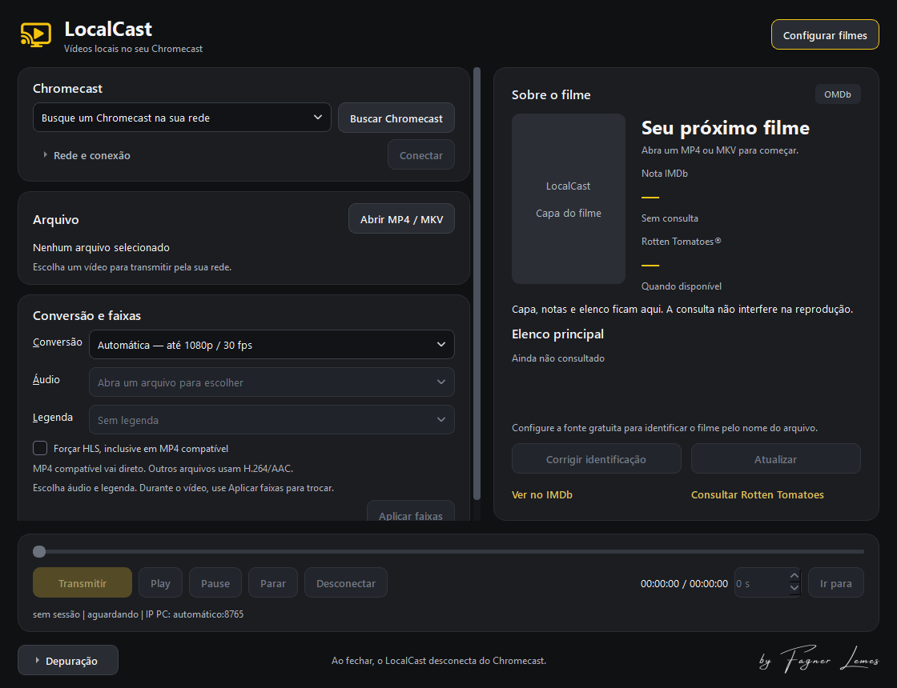

# LocalCast

**Seus filmes do Windows na TV. By Fagner Lemes.**

Aplicativo desktop para transmitir arquivos MP4 e MKV pela rede local a dispositivos Google Cast, com perfil padrão de conversão voltado ao Chromecast de 2ª geração. A compatibilidade com outros modelos deve ser validada no aparelho.

**Versão pública: 0.1.0 · Windows x64 · Python + PySide6 · Código sob MIT**

[Baixar LocalCast.exe — Google Drive](https://drive.google.com/file/d/1I4sgGJAjniQp1Ab4jVNwm8SpcPJC09z0/view?usp=sharing) · [Notas da versão](CHANGELOG.md) · [Relatar problema](https://github.com/fagnerlemes/LocalCast/issues)



## Usar o programa

1. Baixe **LocalCast.exe** pelo link acima e abra com dois cliques. Inclui Python, dependências, FFmpeg e FFprobe; não exige Python instalado no Windows.
2. Mantenha PC e Chromecast na mesma rede. Se o Windows solicitar, permita acesso à **rede privada**.
3. Clique **Buscar Chromecast**, escolha o aparelho e **Conectar** para mostrar a tela de espera.
4. Abra o MP4/MKV, selecione áudio/legenda e clique **Transmitir**. Também pode transmitir diretamente sem usar Conectar antes.
5. Use play, pausa e a barra de posição. **Aplicar faixas** troca áudio/legenda durante a reprodução. **Parar** retorna à espera; **Desconectar** ou fechar encerra a sessão Cast.

O aplicativo precisa permanecer aberto enquanto serve o vídeo à TV. Não precisa instalar nada no Chromecast.

## Recursos

- Descoberta via PyChromecast e conexão por IP manual em **Rede e conexão**.
- Servidor HTTP LAN com Range, seek e URLs temporárias por sessão.
- MP4 compatível enviado diretamente; MKV e codecs incompatíveis convertidos sob demanda, sem preparar uma cópia inteira antes.
- HEVC 4K / EAC3 5.1 convertido para H.264 até 1080p/30 e AAC estéreo; opção 720p e tratamento HDR via zscale/tonemap quando disponível.
- Seleção de áudio e legendas embutidas de texto/imagem. Na conversão, as legendas são incorporadas ao vídeo.
- **Original, sem conversão** para enviar os bytes do arquivo, assumindo os limites do aparelho.
- Tema escuro, logo própria, assinatura do autor, depuração recolhida e tela de espera com montagem de filmes.
- Ficha opcional via OMDb: capa, nota IMDb, elenco e nota Rotten Tomatoes quando fornecida pela API.
- Diagnóstico, logs e geração de executável único com PyInstaller.

## Conversão e compatibilidade

| Modo | Comportamento | Limite prático |
|---|---|---|
| Automática | MP4 elegível direto; demais arquivos usam HLS MPEG-TS H.264/AAC | Depende da CPU, rede e aceitação do HLS pelo receiver |
| Forçar HLS | Mesmo um MP4 compatível passa pela conversão | Permite comparar transmissão direta com HLS |
| Original | Envia MP4/MKV sem alterar codecs ou contêiner | MKV/HEVC/EAC3 e faixas podem ser rejeitados; não há fallback automático |

**Abrir MKV no aplicativo não significa que o Chromecast decodifique MKV/HEVC diretamente.** No modo automático, o LocalCast converte seu conteúdo. O Default Media Receiver e o firmware também influenciam o resultado.

Há testes locais com HTTP real, FFmpeg/FFprobe, vídeos sintéticos e receiver simulado. HLS no firmware, filmes longos, HDR real e desempenho devem ser conferidos no seu equipamento: [checklist](docs/TESTES.md) e [resultados locais](docs/VALIDACAO.md).

## Informações dos filmes

A transmissão funciona sem chave. Para habilitar a ficha, obtenha uma chave no [OMDb](https://www.omdbapi.com/apikey.aspx), ative pelo e-mail e cole em **Configurar filmes → Chave OMDb**. Use **Corrigir identificação** quando necessário.

A chave fica no perfil local e não acompanha o código nem o EXE. A API recebe somente título/ano ou ID IMDb. Dados e imagens possuem condições próprias; a MIT do código não se estende a esse conteúdo. [Créditos e licenças de terceiros](THIRD_PARTY_NOTICES.md).

## Executar e editar o código-fonte

Baixe o ZIP em **Code → Download ZIP** ou clone:

```powershell
git clone https://github.com/fagnerlemes/LocalCast.git
cd LocalCast
.\preparar.cmd
```

`preparar.cmd` procura Python 3.11+ x64. Sem Python disponível, oferece preparar um Python privado em `runtime/`, baixado do site oficial conforme `runtime-manifest.json`. Com Python completo instalado, cria `.venv` e instala as dependências.

O repositório não contém binários FFmpeg. Baixe um build x64 pelo [site oficial](https://ffmpeg.org/download.html#build-windows) e coloque **ffmpeg.exe** e **ffprobe.exe** em `tools/`. Requisitos: `libx264`, HEVC/EAC3, AAC, `libass` para texto e `zscale`/`tonemap` para HDR. Alternativas: PATH, `LOCALCAST_FFMPEG` e `LOCALCAST_FFPROBE`.

```powershell
.\diagnostico.cmd
.\iniciar.cmd
```

`iniciar.cmd` abre sem terminal persistente. `iniciar-debug.cmd` mantém o console para diagnóstico. [COMECE-AQUI.txt](COMECE-AQUI.txt) contém a sequência completa.

## Gerar o executável

Com runtime/dependências e `tools/` preparados, feche o EXE antigo e execute:

```powershell
.\gerar-exe.cmd
```

O novo arquivo fica em **LocalCast.exe** e `dist/LocalCast.exe`. Ferramentas de build ficam em `.build-tools/`, com versões e hashes fixados. O código permanece editável; mudanças entram no EXE após recompilação. [Empacotamento e dados do usuário](docs/EXECUTAVEL.md).

## Organização

```text
src/localcast/       Interface, Cast, HTTP, análise, conversão, sessão e metadados
scripts/            Preparação, execução, diagnóstico, testes e build Windows
tests/              Testes locais e integração FFmpeg com mídia sintética
assets/             Logo, assinatura e mídia de espera
docs/               Arquitetura, diagnóstico, compatibilidade e validação
licenses/           Avisos e licenças de dependências distribuídas
.github/            Validação automatizada e modelos de issues
```

Dados do usuário, chaves, logs, runtime e builds ficam fora do Git. O Google Drive hospeda o executável; o GitHub contém o código e sua história.

## Documentação

- [Arquitetura](docs/ARQUITETURA.md) e [diagnóstico](docs/DIAGNOSTICO.md).
- [Testes locais e na TV](docs/TESTES.md) e [validação](docs/VALIDACAO.md).
- [Ficha dos filmes](docs/FILMES-E-VISUAL.md), [logo](docs/LOGO.md) e [tela de espera](docs/TELA-DE-ESPERA.md).
- [Contribuir](CONTRIBUTING.md), [dados em relatos](SECURITY.md) e [histórico](CHANGELOG.md).

## Autoria e licença

**By Fagner Lemes.** Código sob a [licença MIT](LICENSE), preservando os créditos. Dependências, marcas, pôsteres e dados possuem condições próprias: [THIRD_PARTY_NOTICES.md](THIRD_PARTY_NOTICES.md). Projeto independente, sem afiliação a Google, IMDb, OMDb ou Rotten Tomatoes.

A **0.1.0** inicia as versões públicas. Números usados durante o desenvolvimento anterior eram internos.
